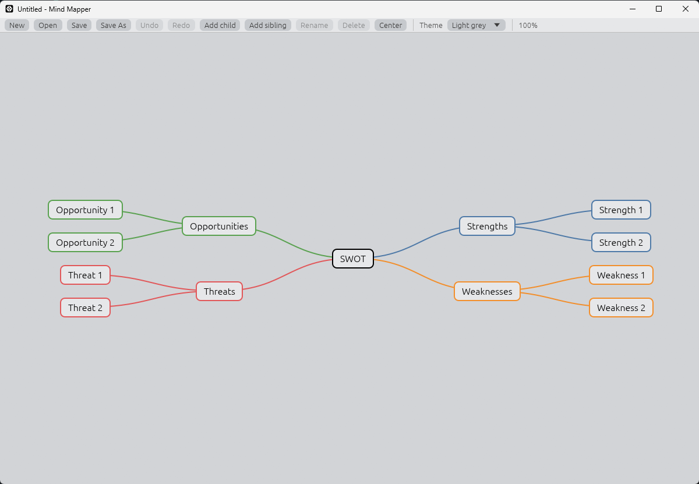

# Mind Mapper

A fast, lightweight desktop app for building mind maps, written in Rust with
[egui](https://github.com/emilk/egui). Start from a template, then grow ideas with the
keyboard, drag branches around and save your maps as plain JSON files.




## Features

- **Template gallery**: start from Blank, Brainstorm, Project Plan, SWOT Analysis,
  Meeting Notes, Decision Making, Study Notes or Weekly Planner. Each card shows a live
  preview of its map.
- **Your own templates**: Save as template adds any map to the gallery, named after its
  central idea; right-click its card to remove it.
- **Keyboard-first editing**: Tab adds a child, Enter adds a sibling, and you type the
  label straight away. The arrow keys move around the map.
- **Drag to rearrange**: moving a node moves all of its descendants with it. Drop it onto
  another node to move the whole branch under that node. Alt+Up/Down swaps a node with the
  sibling above or below it.
- **Multi-select**: Ctrl+click nodes or Shift+drag a box around them, then move, colour,
  copy or delete them together.
- **Tidy up**: one click re-arranges the whole map so nothing overlaps, keeping each branch
  on its side and siblings in their order.
- **Collapse and expand branches** to keep large maps readable. Folded branches stay folded
  when the map is saved.
- **Recent files** on the start screen for quick access to the maps you use most.
- **Export** to a PNG image, an SVG drawing, a PDF document (light colours, for
  printing, with selectable text), a Markdown outline, an OPML outline or a FreeMind map.
- **Import** OPML outlines (from most outliners) and FreeMind / Freeplane `.mm` maps:
  labels, notes, links, colours, folded branches, sides and arrow links come across, then
  the map is tidied.
- **Focus mode**: F6 shows only the selected branch; Esc or F6 brings back the whole map.
- **Cross-links**: dashed arrows between any two nodes, across branches (Ctrl+K or "Link
  to..." in the right-click menu, then click the other node), with an optional label such
  as "depends on". They appear in exports too.
- **Outline view** (Ctrl+Shift+O): the map as an indented list beside the canvas. Click a
  row to select its node, double-click to rename it in place, +/- to fold a branch.
- **Pictures on nodes**: paste an image (Ctrl+V), drop a PNG or JPEG file onto a node, or
  choose "Add picture..." in the right-click menu. Pictures are saved inside the map file
  and appear in PNG, SVG and PDF exports.
- **Find** any node by its text or notes; matches are highlighted and folded branches open
  as needed.
- **Cut, copy and paste branches** as bullet outlines: paste a copied branch into a
  document, or paste a bulleted list from anywhere into the map.
- **Smooth navigation**: zoom with the scroll wheel (anchored at the cursor) and pan by
  dragging the background.
- **Undo/redo**: up to 200 steps (fewer on very large maps, so undo history stays within
  about 256 MB).
- **Seven colour themes**: Dark, Light, Light grey, Dark grey, Dark blue, Light purple and
  Dark purple. Your choice is remembered between runs.
- **Adjustable interface size** (toolbar or Ctrl +/-), also remembered between runs.
- **Multi-line labels**: press Shift+Enter while editing to start a new line.
- **Colours, notes and links**: give any branch its own colour, and attach notes or a web
  link to a node (shown with a folded corner and on hover).
- **Plain JSON files** that are easy to back up, diff or generate with other tools.
- **Safe saving and crash recovery**: saves never leave a half-written file, and unsaved
  work is backed up in the background so it can be restored after a crash.
- **Screen-reader support**: every node on the map is announced by name, nested like the
  map, with its notes, folded state and selection; activating one selects it.
- **Update check**: once a day the app asks GitHub whether a newer version exists and, if
  so, links to it. Only the app's name and version are sent; untick "Check for updates"
  on the start screen to turn it off.
- **Portable builds** for Windows (x86-64) and Linux (x86-64 and ARM64). No installer or
  runtime needed.

## Getting started

### Requirements

- [Rust](https://rustup.rs/) 1.88 or newer
- **Windows**: nothing else
- **Linux**: the system libraries egui needs for windowing. On Debian/Ubuntu:

  ```sh
  sudo apt-get install libxcb-render0-dev libxcb-shape0-dev libxcb-xfixes0-dev \
      libxkbcommon-dev libssl-dev
  ```

  File dialogs use the XDG desktop portal, which most desktop environments provide
  (without it, they fall back to `zenity` if that is installed).

### Download

Tagged versions are published on the repository's **Releases** page as ready-to-run
archives for Windows x86-64, Linux x86-64 and Linux ARM64. Unpack one and run
`mind_mapper` (or `mind_mapper.exe`). Each archive includes `THIRD_PARTY_NOTICES.txt`, the
licenses of the open-source components built into the program.

### Build from source

```sh
git clone https://github.com/BrandonG2001/mind_mapper.git
cd mind_mapper
cargo run --release
```

The executable is written to `target/release/mind_mapper` (`mind_mapper.exe` on Windows).
It is self-contained, so you can copy it anywhere and run it.

To open a map directly, pass its path:

```sh
mind_mapper path/to/ideas.json
```

## Using Mind Mapper

### Mouse

| Action | How |
|---|---|
| Select a node | Click it |
| Select several nodes | Ctrl+click each one (again to deselect), or Shift+drag a box around them (Ctrl+Shift+drag adds to the selection) |
| Rename a node | Double-click it |
| Move a node and its branch | Drag it (with several selected, they all move) |
| Attach a branch to a different node | Drag it onto that node (the target is highlighted) and release |
| Collapse or expand a branch | Click the round handle beside the node (**+** on folded nodes, **-** on the selected node) |
| Colour, notes, rename, reorder, focus on or delete a node | Right-click it (colour and delete apply to every selected node) |
| Remove one of your templates | Right-click its card on the start screen |
| Link two nodes | Right-click the first, choose **Link to...**, then click the second (Esc cancels) |
| Label or remove a link | Right-click either node and choose **Label link ...** or **Remove link ...** |
| Add a picture to a node | Drop a PNG or JPEG file onto it, or right-click it and choose **Add picture...** |
| Select or rename from the outline | Click a row to select its node; double-click to rename it there |
| Read a node's notes and link | Hover over it |
| Pan the view | Drag empty space (or right-drag anywhere) |
| Zoom | Scroll wheel |

### Keyboard

| Shortcut | Action |
|---|---|
| Tab | Add a child to the selected node |
| Enter | Add a sibling to the selected node |
| F2 | Rename the selected node |
| Ctrl + / Ctrl - / Ctrl 0 | Make the interface larger / smaller / reset it to 100% |
| Delete | Delete the selected nodes and their branches |
| Home | Fit the whole map in the window |
| Ctrl+L | Tidy up: arrange the map without overlaps |
| Space | Collapse or expand the selected node's branch |
| Arrow keys | Move the selection: Left/Right go out to a child or back to the parent (mirrored on the left half of the map), Up/Down go between siblings |
| Alt+Up / Alt+Down | Swap the selected node (with its branch) with the sibling above / below it |
| Ctrl+E | Export as PNG, SVG, PDF, Markdown, OPML or FreeMind (chosen by the file extension) |
| Ctrl+F | Find; Enter / Shift+Enter (or F3 / Shift+F3) go to the next / previous match, Esc closes |
| Esc | Cancel a link being made, close the find bar, or leave focus mode |
| Ctrl+I | Show or hide the side panel with the selected node's colour, notes and link |
| Ctrl+C / Ctrl+X | Copy / cut the selected branches (or copy the whole map) as an indented outline |
| Ctrl+V | Paste an outline (Markdown bullets, numbered items or indented lines) under the selected node, or a copied image onto it |
| Ctrl+Shift+O | Show or hide the outline view |
| Ctrl+Z / Ctrl+Y | Undo / redo (Ctrl+Shift+Z also redoes) |
| Ctrl+N | New map (opens the template gallery) |
| Ctrl+O | Open a map, or import an OPML (`.opml`) or FreeMind (`.mm`) file |
| F6 | Focus mode: show only the selected branch, or the whole map again |
| Ctrl+K | Link the selected node to the next node you click |
| Ctrl+S / Ctrl+Shift+S | Save / save as |

While renaming, Enter keeps the new label, Shift+Enter starts a new line and Esc cancels.
On the template gallery, Esc returns to the map you were editing.

An imported OPML or FreeMind file opens as a new, unsaved map: Save asks where to keep it as
a mind-map file, so the original is never overwritten. OPML has no colours, folded state or
sides, so those (and cross-links, FreeMind's arrow links) come from FreeMind files only;
neither format keeps node positions.

The window title shows `*` when there are unsaved changes. You are asked before unsaved
work is discarded by opening another map, choosing a template or closing the window. If
another window or program changed the file since you opened it, saving asks before
replacing those changes. These questions appear inside the window; Esc or a click outside
them cancels.

### Crash recovery

While a map has unsaved changes, a copy is written in the background at most every 20
seconds. If Mind Mapper closes unexpectedly, the next launch shows a banner on the start
screen where you can **Restore** that work or **Discard** it. The copy is deleted when you
save, or when you choose to discard your changes.

Each open window keeps its own copy, so several windows can run side by side safely. Only
work from windows that are no longer running is offered for restoring; if several crashed,
their work is offered one after another.

## File format

Maps are saved as JSON. Nodes are listed parents-first, and each node refers to its
parent by its position in the list:

```json
{
  "version": 1,
  "nodes": [
    { "parent": null, "text": "Project", "position": { "x": 0.0, "y": 0.0 } },
    { "parent": 0, "text": "Goals", "position": { "x": 230.0, "y": -140.0 } },
    { "parent": 1, "text": "Objective 1", "position": { "x": 460.0, "y": -168.0 } }
  ]
}
```

Optional fields appear only when used, so files from older versions load unchanged:
`"collapsed": true` on a folded node, `"color": "#rrggbb"` for a chosen colour, `"note"`
for notes, `"link"` for a web address and `"picture"` for a picture, stored as a data URL
(`"data:image/png;base64,..."`, at most 8 MB). Cross-links are listed after the nodes, by
node position, as `"links": [{ "from": 6, "to": 1, "label": "depends on" }]`. Versions
before 0.9 ignore links, and before 0.10 pictures and link labels.

Files are checked when they are opened. A malformed file, or one whose nodes don't form a
single tree, is rejected with an error message rather than partially loaded.

Saving writes to a temporary file first and then swaps it into place, so a crash or full
disk mid-save leaves the previous version intact.

Settings (`settings.json`: theme, interface size, recent files and the update-check
setting), the window size, your templates (one map file each in `templates/`) and the
crash-recovery copies live in the app's data folder. Settings are shared safely between
open windows: each change is merged into the file rather than overwriting it.

| OS | Folder |
|---|---|
| Windows | `%APPDATA%\Mind Mapper\data\` |
| Linux | `~/.local/share/mindmapper/` (or `$XDG_DATA_HOME/mindmapper/`) |

## Development

```sh
cargo test                                  # run the unit tests
cargo clippy --all-targets -- -D warnings   # lint
cargo fmt --check                           # check formatting
```

`cargo test` includes end-to-end UI tests ([`src/app/ui_tests.rs`](src/app/ui_tests.rs))
that drive the real app with simulated mouse and keyboard input through
[egui_kittest](https://crates.io/crates/egui_kittest), with no window or GPU needed. They
also fail if any widget lacks an accessible name for screen readers.

The tests never use the network. One test checks the update check against the real GitHub
API and only runs when asked for: `cargo test -- --ignored live_github`.

GitHub Actions runs formatting, clippy and the tests on Windows, Linux x86-64 and Linux
ARM64 (on real ARM hardware) for every push and pull request, starts the Linux release
builds on a virtual screen to check they run, and checks that every dependency's license
is one accepted in [`about.toml`](about.toml). Pushing a tag such as `v0.2.0`
builds the portable archives and publishes them as a GitHub Release:

```sh
git tag v0.2.0
git push origin v0.2.0
```

The release archives include a `THIRD_PARTY_NOTICES.txt` generated by
[cargo-about](https://github.com/EmbarkStudios/cargo-about). To generate it locally:

```sh
cargo install --locked cargo-about --features cli
cargo about generate about.hbs -o THIRD_PARTY_NOTICES.txt
```

### Project layout

| File | Purpose |
|---|---|
| [`src/model.rs`](src/model.rs) | The mind-map tree and its editing operations |
| [`src/history.rs`](src/history.rs) | Undo/redo within a memory budget |
| [`src/background.rs`](src/background.rs) | Exports and recovery copies on background threads |
| [`src/camera.rs`](src/camera.rs) | Pan and zoom transform |
| [`src/storage.rs`](src/storage.rs) | JSON load and save, atomic file writes |
| [`src/recovery.rs`](src/recovery.rs) | Background copy of unsaved work for crash recovery |
| [`src/templates.rs`](src/templates.rs) | Built-in templates |
| [`src/user_templates.rs`](src/user_templates.rs) | Templates saved by the user, in the data folder |
| [`src/formats.rs`](src/formats.rs) | OPML ([`opml.rs`](src/formats/opml.rs)) and FreeMind ([`freemind.rs`](src/formats/freemind.rs)) import and export |
| [`src/layout.rs`](src/layout.rs) | Automatic, overlap-free layout (Tidy up, templates, imports) |
| [`src/recent.rs`](src/recent.rs) | The recent-files list |
| [`src/navigation.rs`](src/navigation.rs) | Arrow-key movement between nodes |
| [`src/export.rs`](src/export.rs) | PNG, SVG, PDF, Markdown, OPML and FreeMind export |
| [`src/picture.rs`](src/picture.rs) | Pictures on nodes: reading, storing and scaling them |
| [`src/update.rs`](src/update.rs) | Asking GitHub for the latest release |
| [`src/search.rs`](src/search.rs) | The find bar and node matching |
| [`src/clipboard.rs`](src/clipboard.rs) | Branches to and from clipboard outlines |
| [`src/details.rs`](src/details.rs) | Side panel for colour, notes and link |
| [`src/settings.rs`](src/settings.rs) | Settings file shared between windows |
| [`src/icon.rs`](src/icon.rs) | The window icon, drawn from `assets/icon.svg` |
| [`build.rs`](build.rs) | Embeds `assets/icon.ico` in the Windows executable |
| [`src/map_view.rs`](src/map_view.rs) | Drawing a map (used by the editor and the thumbnails) |
| [`src/start_screen.rs`](src/start_screen.rs) | The template gallery (built-in and your own) |
| [`src/theme.rs`](src/theme.rs) | Colour themes and saving the chosen one |
| [`src/app.rs`](src/app.rs) | App state, actions and keyboard shortcuts |
| [`src/app/canvas.rs`](src/app/canvas.rs) | Map canvas: mouse, inline label editor, right-click menu |
| [`src/app/editing.rs`](src/app/editing.rs) | Undoable edits, folding, navigation, clipboard |
| [`src/app/panels.rs`](src/app/panels.rs) | Toolbar, details panel, find bar, start-screen choices |
| [`src/app/files.rs`](src/app/files.rs) | Open and import, save (with the overwrite check), export, templates, settings |
| [`src/app/focus.rs`](src/app/focus.rs) | Focus mode: one branch on its own |
| [`src/app/links.rs`](src/app/links.rs) | Making, labelling and removing cross-links |
| [`src/app/outline.rs`](src/app/outline.rs) | The outline view |
| [`src/app/pictures.rs`](src/app/pictures.rs) | Adding pictures by file, paste or drag and drop |
| [`src/app/questions.rs`](src/app/questions.rs) | In-window questions: discard unsaved work, overwrite |
| [`src/app/selection.rs`](src/app/selection.rs) | Multi-select, and the edits that act on every selected node |
| [`src/app/autosave.rs`](src/app/autosave.rs) | Recovery copies and background jobs |
| [`src/app/updates.rs`](src/app/updates.rs) | The background update check and its setting |
| [`src/app/accessibility.rs`](src/app/accessibility.rs) | Map nodes in the accessibility tree, for screen readers |

### Changing the icon

[`assets/icon.svg`](assets/icon.svg) is the source artwork; the window icon is drawn from it
at startup. Windows also needs [`assets/icon.ico`](assets/icon.ico) (16 to 256 px) for the
executable's icon, so regenerate that file from the SVG after editing it, with any SVG-to-ICO
converter.

### Adding a template

Add an entry to `TEMPLATES` in [`src/templates.rs`](src/templates.rs) and increase the
array length by one:

```rust
Template {
    name: "Reading List",
    description: "Track books to read, in progress and finished.",
    root: node!("Books" => [
        node!("To read" => [node!("Title")]),
        node!("Reading"),
        node!("Finished"),
    ]),
},
```

The node layout is computed automatically, and the new template appears in the gallery.

### Adding a theme

Add a variant to `ColorTheme` in [`src/theme.rs`](src/theme.rs) and append it to the
`ALL` list, which controls the picker. The compiler then points to the remaining places to
fill in: `name`, `is_dark` and `palette`, which takes five colours.

## License

Licensed under either of

- Apache License, Version 2.0 ([LICENSE-APACHE](LICENSE-APACHE) or
  <https://www.apache.org/licenses/LICENSE-2.0>)
- MIT License ([LICENSE-MIT](LICENSE-MIT) or <https://opensource.org/licenses/MIT>)

at your option.

Unless you explicitly state otherwise, any contribution intentionally submitted for
inclusion in the work by you, as defined in the Apache-2.0 license, shall be dual licensed
as above, without any additional terms or conditions.
