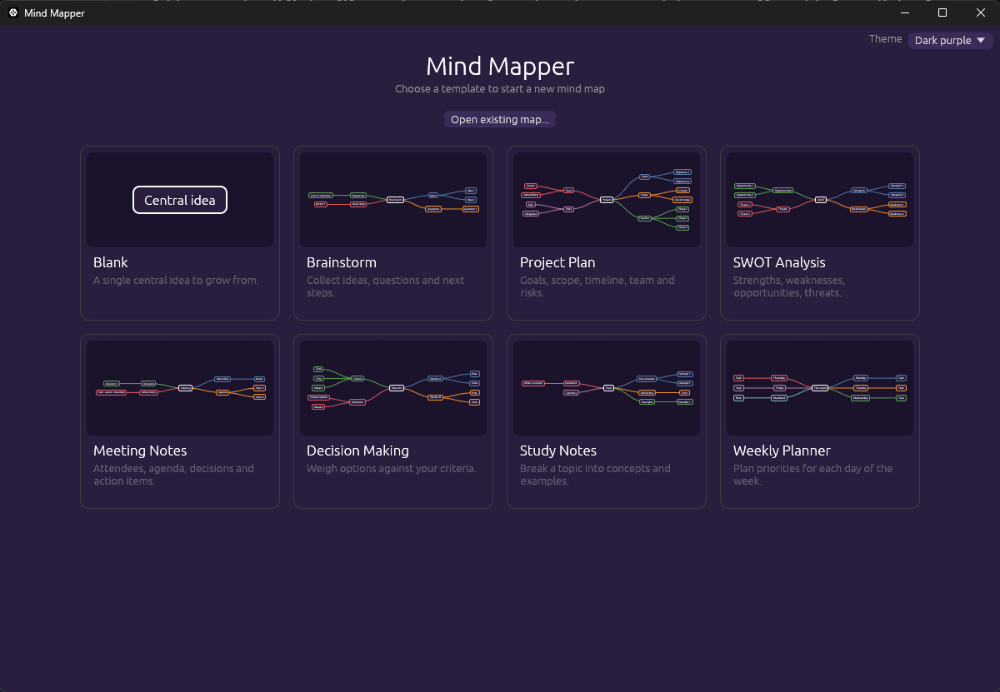

# Mind Mapper

A fast, lightweight desktop app for building mind maps, written in Rust with
[egui](https://github.com/emilk/egui). Start from a template, then grow ideas with the
keyboard, drag branches around and save your maps as plain JSON files.




## Features

- **Template gallery**: start from Blank, Brainstorm, Project Plan, SWOT Analysis,
  Meeting Notes, Decision Making, Study Notes or Weekly Planner. Each card shows a live
  preview of its map.
- **Keyboard-first editing**: Tab adds a child, Enter adds a sibling, and you type the
  label straight away.
- **Drag to rearrange**: moving a node moves all of its descendants with it.
- **Smooth navigation**: zoom with the scroll wheel (anchored at the cursor) and pan by
  dragging the background.
- **Undo/redo**: up to 200 steps.
- **Seven colour themes**: Dark, Light, Light grey, Dark grey, Dark blue, Light purple and
  Dark purple. Your choice is remembered between runs.
- **Plain JSON files** that are easy to back up, diff or generate with other tools.
- **Single portable executable** on Windows. No installer or runtime needed.

## Getting started

### Requirements

- [Rust](https://rustup.rs/) 1.88 or newer
- **Windows**: nothing else
- **Linux**: the system libraries egui needs for windowing. On Debian/Ubuntu:

  ```sh
  sudo apt-get install libxcb-render0-dev libxcb-shape0-dev libxcb-xfixes0-dev \
      libxkbcommon-dev libssl-dev
  ```

  File dialogs use the XDG desktop portal, which most desktop environments provide.

### Build and run

```sh
git clone https://github.com/BrandonG2001/mind_mapper.git
cd mind_mapper
cargo run --release
```

The executable is written to `target/release/mind_mapper` (`mind_mapper.exe` on Windows).
It is self-contained, so you can copy it anywhere and run it.

To open a map directly, pass its path:

```sh
mind_mapper path/to/ideas.json
```

## Using Mind Mapper

### Mouse

| Action | How |
|---|---|
| Select a node | Click it |
| Rename a node | Double-click it |
| Move a node and its branch | Drag it |
| Pan the view | Drag empty space (or right-drag anywhere) |
| Zoom | Scroll wheel |

### Keyboard

| Shortcut | Action |
|---|---|
| Tab | Add a child to the selected node |
| Enter | Add a sibling to the selected node |
| F2 | Rename the selected node |
| Delete | Delete the selected node and its branch |
| Home | Fit the whole map in the window |
| Ctrl+Z / Ctrl+Y | Undo / redo (Ctrl+Shift+Z also redoes) |
| Ctrl+N | New map (opens the template gallery) |
| Ctrl+O | Open a map |
| Ctrl+S / Ctrl+Shift+S | Save / save as |

While renaming, Enter keeps the new label and Esc cancels. On the template gallery, Esc
returns to the map you were editing.

The window title shows `*` when there are unsaved changes. You are asked before unsaved
work is discarded by opening another map, choosing a template or closing the window.

## File format

Maps are saved as JSON. Nodes are listed parents-first, and each node refers to its
parent by its position in the list:

```json
{
  "version": 1,
  "nodes": [
    { "parent": null, "text": "Project", "position": { "x": 0.0, "y": 0.0 } },
    { "parent": 0, "text": "Goals", "position": { "x": 230.0, "y": -140.0 } },
    { "parent": 1, "text": "Objective 1", "position": { "x": 460.0, "y": -168.0 } }
  ]
}
```

Files are checked when they are opened. A malformed file, or one whose nodes don't form a
single tree, is rejected with an error message rather than partially loaded.

The theme and window size are kept separately, in eframe's settings file
(`%APPDATA%\Mind Mapper\data\app.ron` on Windows, or your user data directory on
Linux).

## Development

```sh
cargo test                                  # run the unit tests
cargo clippy --all-targets -- -D warnings   # lint
cargo fmt --check                           # check formatting
```

### Project layout

| File | Purpose |
|---|---|
| [`src/model.rs`](src/model.rs) | The mind-map tree and its editing operations |
| [`src/history.rs`](src/history.rs) | Undo/redo |
| [`src/camera.rs`](src/camera.rs) | Pan and zoom transform |
| [`src/storage.rs`](src/storage.rs) | JSON load and save |
| [`src/templates.rs`](src/templates.rs) | Built-in templates and their automatic layout |
| [`src/map_view.rs`](src/map_view.rs) | Drawing a map (used by the editor and the thumbnails) |
| [`src/start_screen.rs`](src/start_screen.rs) | The template gallery |
| [`src/theme.rs`](src/theme.rs) | Colour themes and saving the chosen one |
| [`src/app.rs`](src/app.rs) | The application window, toolbar and input handling |

### Adding a template

Add an entry to `TEMPLATES` in [`src/templates.rs`](src/templates.rs) and increase the
array length by one:

```rust
Template {
    name: "Reading List",
    description: "Track books to read, in progress and finished.",
    root: node!("Books" => [
        node!("To read" => [node!("Title")]),
        node!("Reading"),
        node!("Finished"),
    ]),
},
```

The node layout is computed automatically, and the new template appears in the gallery.

### Adding a theme

Add a variant to `ColorTheme` in [`src/theme.rs`](src/theme.rs) and append it to the
`ALL` list, which controls the picker. The compiler then points to the remaining places to
fill in: `name`, `is_dark` and `palette`, which takes five colours.

## License

Licensed under either of

- Apache License, Version 2.0 ([LICENSE-APACHE](LICENSE-APACHE) or
  <https://www.apache.org/licenses/LICENSE-2.0>)
- MIT License ([LICENSE-MIT](LICENSE-MIT) or <https://opensource.org/licenses/MIT>)

at your option.

Unless you explicitly state otherwise, any contribution intentionally submitted for
inclusion in the work by you, as defined in the Apache-2.0 license, shall be dual licensed
as above, without any additional terms or conditions.
